<picture>
  <source media="(prefers-color-scheme: dark)" srcset="assets/banner-dark.svg">
  <source media="(prefers-color-scheme: light)" srcset="assets/banner-light.svg">
  
</picture>

  
  
  
  

## Sobre mim

Sou o Daniel, fundador da **[PazConcept](https://www.pazconcept.com.br)**, em João Pessoa (PB). Comecei pelo design — identidade visual e branding — e hoje uso o mesmo olhar para construir software: sistemas web e apps para negócios brasileiros, do consultório de nutrição à distribuidora.

Gosto de cuidar do produto inteiro: da marca e da interface até o banco de dados, os testes e o deploy.

- **Web:** SaaS em Next.js 16 + PostgreSQL (Prisma ou Supabase), na Vercel
- **Mobile:** apps em React Native CLI para Android e iOS
- **Integrações:** Pix, NFC-e, WhatsApp, Telegram e ERP (WinThor/Oracle)
- **Qualidade:** Vitest, Playwright e pgTAP no CI de cada sistema

## Projetos

> A maioria dos repositórios é privada. Os links levam ao sistema no ar ou ao código, quando ele é público.

### SaaS e sistemas

| Projeto | O que é | Stack | Status |
| :--- | :--- | :--- | :--- |
| **[DietSpace](https://dietspace.com.br)** | Gestão nutricional para consultório: anamnese, antropometria, planos alimentares (TACO), agenda e portal do paciente | `Next.js` `Prisma` `Neon` `Auth.js` | no ar |
| **[PerformX](https://performx.pazconcept.com.br)** | Treino para personal trainer: biblioteca de exercícios, montador de ficha e app do aluno com timer e registro offline | `Next.js` `Prisma` `Neon` `PWA` | no ar |
| **Ocorrências · PB Plast** | Ocorrências de entrega de uma distribuidora: acertos, devoluções, reentregas, trocas e cargas ao vivo do ERP, com conector Windows para o Oracle | `Python` `Flask` `Supabase` `Oracle` | no ar |
| **GestaoHub** | Operação de varejo: app de validade e conferência, painel web de BI e BFF | `React Native` `React` `Express` `Supabase` | no ar |
| **[ElaraSpace](https://elaraspace.pazconcept.com.br)** | Tratativa de ocorrências de entrega: PWA offline do motorista, painel em tempo real e aviso ao vendedor | `React` `Vite` `Supabase Realtime` | piloto |
| **[PitSpace](https://pitspace.pazconcept.com.br)** | Gestão de oficinas: OS pela placa, orçamento aprovado pelo link, estoque e caixa (demonstração no ar) | `Next.js` `Prisma` `Supabase` `S3` | em desenvolvimento |
| **Pronto!** | Autoatendimento para lanchonetes: totem, PDV, cozinha (KDS), painel de senhas, Pix e NFC-e | `React` `Vite` `Supabase` `Mercado Pago` | em desenvolvimento |
| **[PazConcept](https://www.pazconcept.com.br)** | Site da PazConcept, com vitrine dos sistemas e um universo de estrelas interativo | `Next.js` `Tailwind` `Framer Motion` | no ar |

### Apps e jogos

| Projeto | O que é | Stack |
| :--- | :--- | :--- |
| **[Foteball-app](https://github.com/Danpazexe/Foteball-app)** | Jogo de gerência de futebol brasileiro estilo Brasfoot, com Séries A a D e mercado de transferências | `React Native` `Reanimated` `op-sqlite` `Zustand` |
| **[Comanda-app](https://github.com/Danpazexe/Comanda-app)** | Comandas para restaurante: mesas, pedidos, monitor de cozinha e relatórios | `React Native` `Firebase` `Vite` |
| **Palavrix** | Jogo de adivinhação de palavras em português, estilo Termo | `React Native` `Lottie` |
| **Pblist** | Lista de produtos com cadastro, busca e filtros | `React Native` `TypeScript` |

### Ferramentas e infra

| Projeto | O que é | Stack |
| :--- | :--- | :--- |
| **Lobby** | Sede da PazConcept: escritório 2D em pixel art com os projetos e os agentes trabalhando ao vivo | `Next.js` `Canvas 2D` `SSE` |
| **Template SaaS** | Kit whitelabel para novos sistemas: autenticação com papéis, PWA e design system prontos | `Next.js` `Prisma` `Auth.js` `PWA` |
| **Central de Deploys** | Painel em tempo real dos projetos na Vercel: deploys, build, ping dos sites e vulnerabilidades | `Next.js` `Vercel API` `GitHub API` |
| **BrainVault** | Cérebro digital em Markdown versionado, com CLI, interface web, captura pelo Telegram e servidor MCP | `Node.js` `GitHub Actions` `MCP` |
| **Workflows** | GitHub Actions reutilizáveis dos sistemas: backup cifrado, alerta de deploy e testes E2E | `GitHub Actions` |
| **[ServidorPaz-infra](https://github.com/Danpazexe/ServidorPaz-infra)** | Servidor Minecraft Paper com plugins, datapacks e um plugin Java próprio (arquivado) | `Java` `Gradle` `Paper` |

## Stack

<picture>
  <source media="(prefers-color-scheme: dark)" srcset="assets/stack-dark.svg">
  <source media="(prefers-color-scheme: light)" srcset="assets/stack-light.svg">
  
</picture>

## Números

  <picture>
    <source media="(prefers-color-scheme: dark)" srcset="https://github-readme-stats-seven-livid-24.vercel.app/api?username=Danpazexe&show_icons=true&theme=github_dark&hide_border=true&count_private=true&bg_color=0d1117">
    
  </picture>
  <picture>
    <source media="(prefers-color-scheme: dark)" srcset="https://github-readme-stats-seven-livid-24.vercel.app/api/top-langs/?username=Danpazexe&layout=compact&theme=github_dark&hide_border=true&langs_count=6&bg_color=0d1117">
    
  </picture>

<picture>
  <source media="(prefers-color-scheme: dark)" srcset="https://raw.githubusercontent.com/Danpazexe/Danpazexe/output/github-contribution-grid-snake-dark.svg">
  <source media="(prefers-color-scheme: light)" srcset="https://raw.githubusercontent.com/Danpazexe/Danpazexe/output/github-contribution-grid-snake.svg">
  
</picture>

Banner e card de stack gerados por <code>assets/gerar.py</code>.

